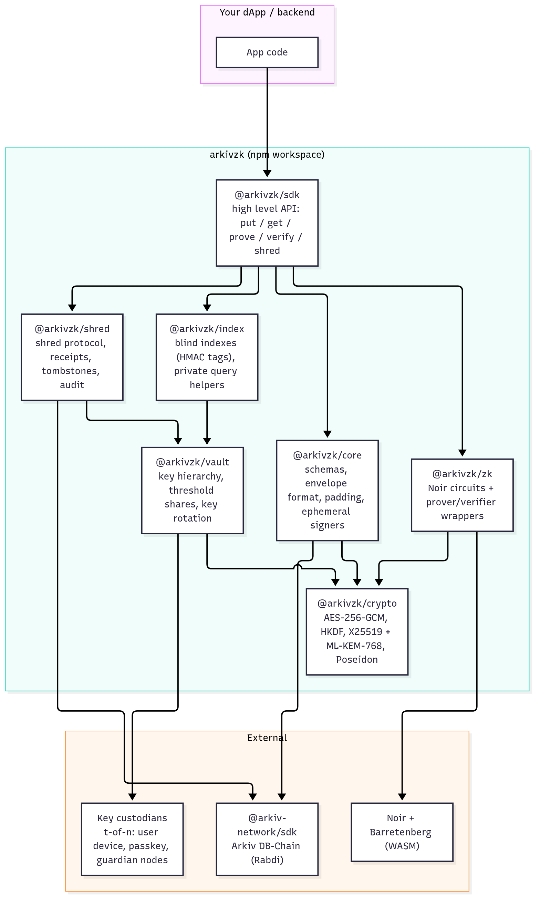
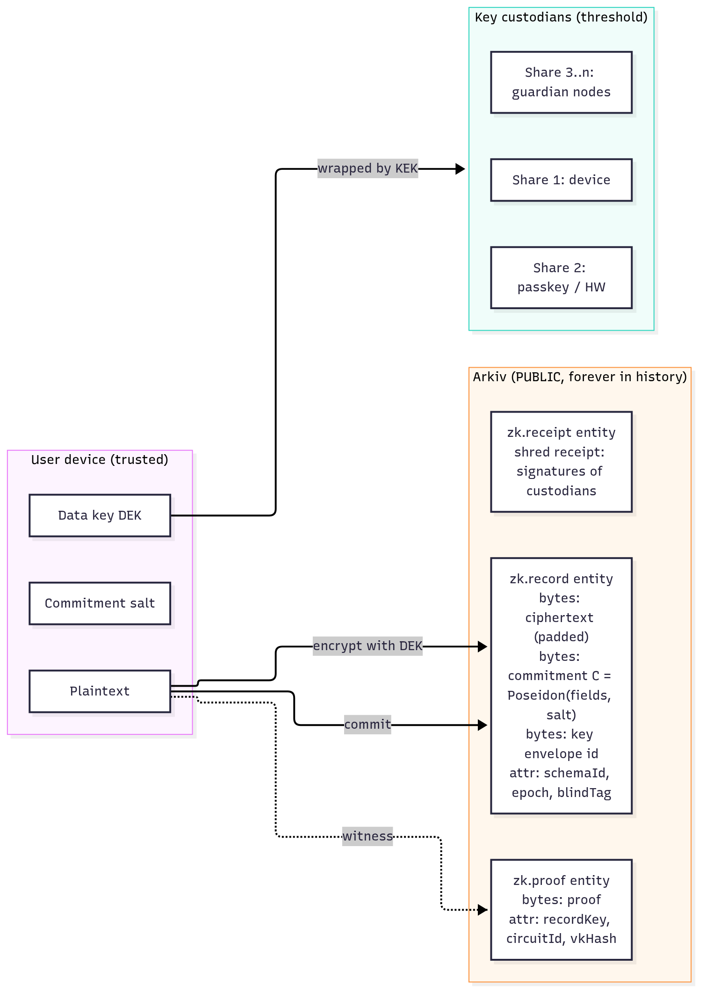
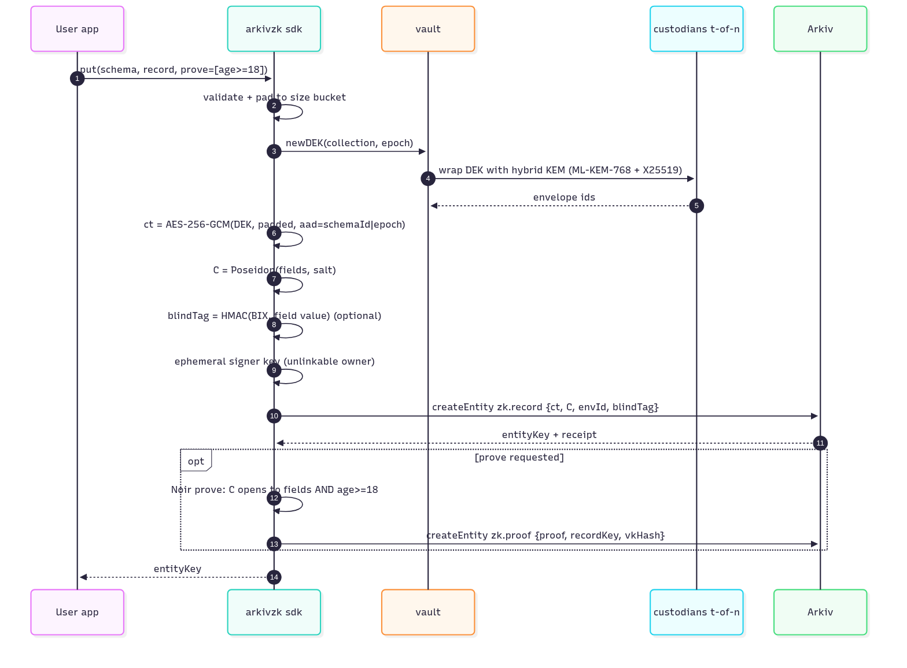
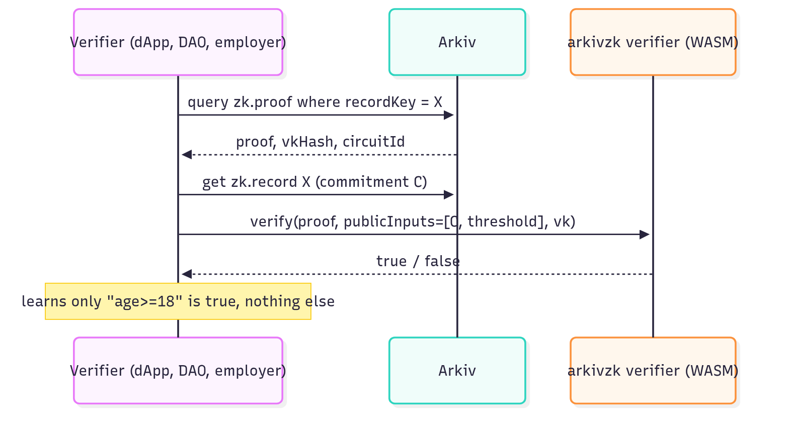
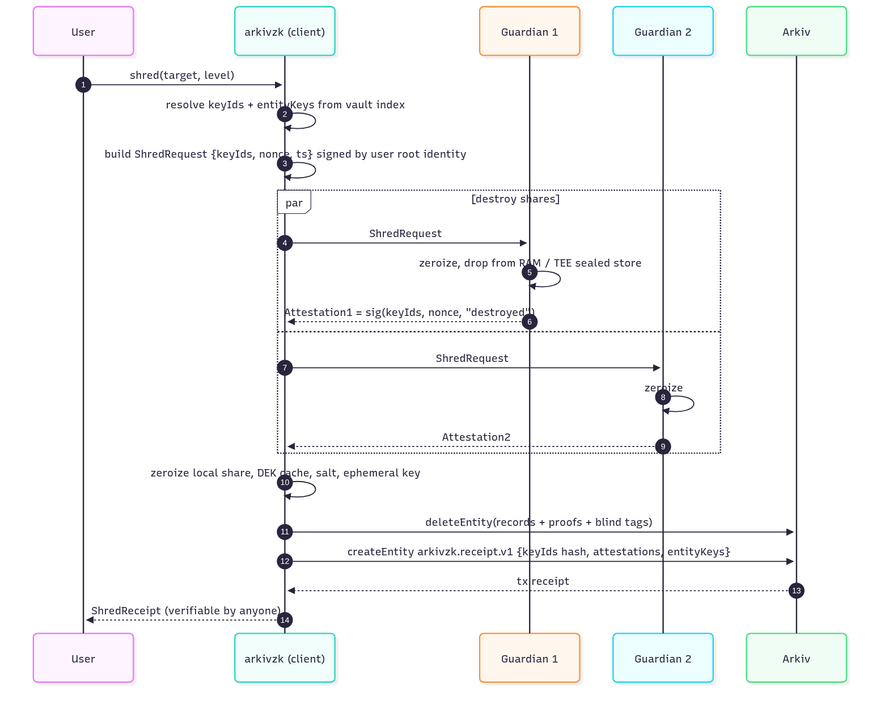
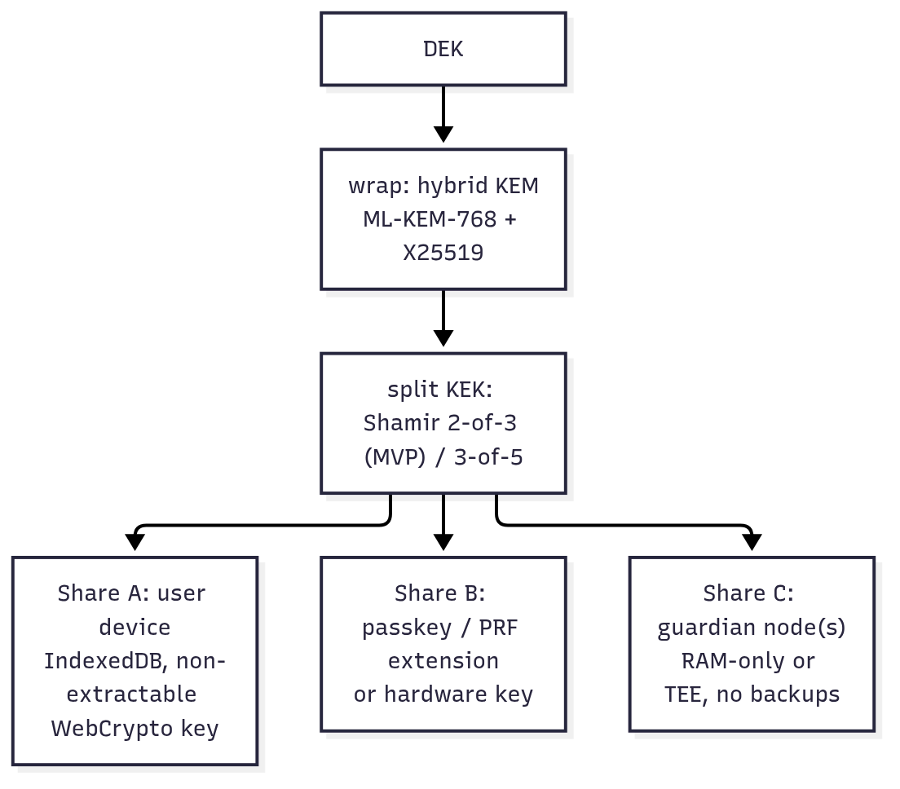
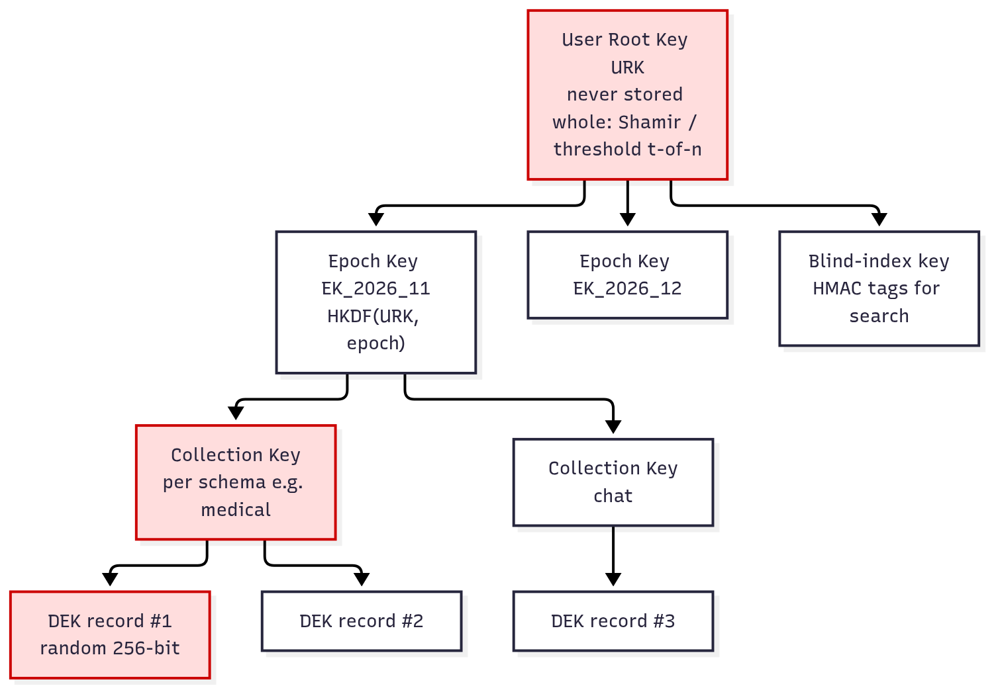
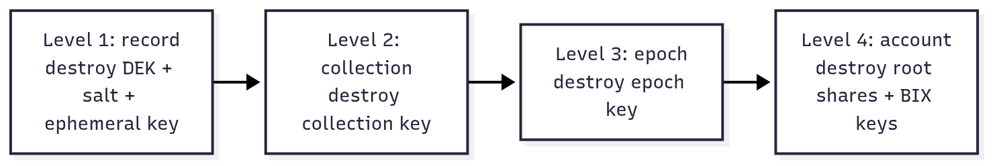
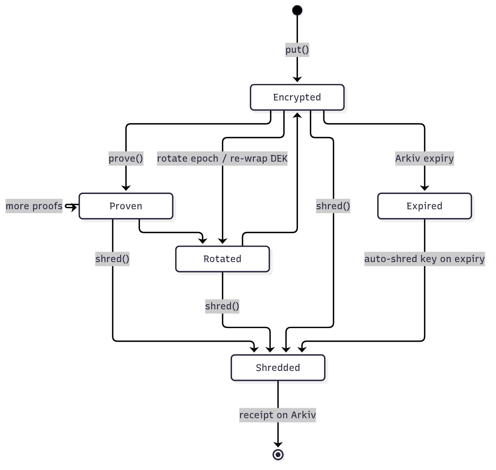
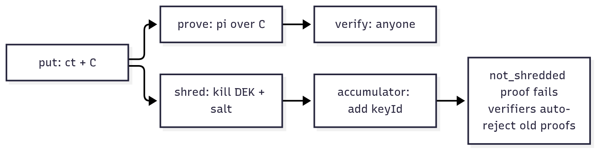

# Kalypso


_Package and on-chain names stay `arkivzk` (`@arkivzk/sdk`, `app = "arkivzk"`), so existing records and receipts on Rabdi keep working._

> Private-by-default data on a public-by-default database.
> **ZK end-to-end** + **god-level crypto-shredding** for [Arkiv](https://docs.arkiv.network).

Arkiv stores everything in public: attributes, owner, creator, expiry, and the full transaction
history (calldata). `deleteEntity` only removes an entity from *current state*. Any node runner
or archive indexer that synced the old blocks still holds the bytes forever.

**Kalypso** fixes both problems from the client side, without changing Arkiv:

| Problem | Kalypso answer |
|---|---|
| Data is public | Plaintext never leaves the user's device. Only ciphertext + commitments go on-chain. |
| Need to *use* private data | ZK proofs over committed data: prove a fact (age > 18, balance in range, member of group, record unchanged) without revealing it. |
| Writer is public (`$owner`, tx sender) | Ephemeral signer per write + optional ZK membership proof ("someone in group G wrote this"). |
| Delete is not real delete | **Crypto-shredding**: destroy the key, not the data. Old ciphertext on every old node becomes random noise. |
| "Harvest now, decrypt later" | Hybrid post-quantum key wrapping (ML-KEM-768 + X25519), so archived ciphertext stays safe even later. |

## Status (what is real today)

| Area | Status |
|---|---|
| Client-side AES-256-GCM + size-bucket padding | ✅ implemented, tested |
| Poseidon2 commitments + Noir range/equality proofs (UltraHonk) | ✅ implemented, tested |
| Public verification with Arkiv-hosted VK registry | ✅ implemented |
| 2-of-3 key custody, guardians, ML-KEM-768+X25519 share transport | ✅ implemented, tested against real guardian processes |
| Crypto-shred + signed attestations + on-chain receipt, one atomic tx | ✅ implemented |
| Lease manager (renew data + keys together, reminders, expiry erasure) | ✅ implemented |
| Query planner (pushdown, projections, IN-batching, keyset, explain) | ✅ implemented |
| Archive node indexer (raw calldata capture) | ✅ implemented, captures live Rabdi traffic |
| Encrypted attachments on Swarm | ✅ implemented, checked in the browser against a local Bee cluster (`fdp-play`): Swarm holds only ciphertext, the image decrypts on device |
| Recovery kit (lost device) | ✅ implemented, tested |
| Ephemeral per-record signers + gas relayer (records unlinkable to your wallet) | ✅ implemented |
| Two-level keys: collection (schema × month) key + record key; epoch & account shred | ✅ implemented |
| Blind-index exact-match search on encrypted fields | ✅ implemented |
| Range search and COUNT on encrypted fields | ✅ implemented, checked live against decrypt-everything ([07 §5](docs/07-performance.md#5-queries-what-arkiv-does-what-it-cant-do-on-encrypted-data-and-what-arkivzk-adds)) |
| Relational layer: atomic multi-insert, 1:N + M:N blind foreign keys, batched JOIN, orphans, cascade shred/renew, relations restored on recovery | ✅ implemented, checked live ([07 §6](docs/07-performance.md#6-relational-layer-on-encrypted-data)) |
| TEE-attested guardians | ❌ not implemented: needs SGX/TDX/Nitro hardware we don't have. Guardians are trusted via signatures + 2-of-3 threshold only. |

## Live on Arkiv Rabdi (chain 7794095)

| | |
|---|---|
| Live proof (age ≥ 18, record kept 180 days) | `/verify/0x814eb35926ead5e8ad0ea97ec7ce04ac4d26d1b7e446096ffdc316da3fa486db` (record `0xb6a5f66cf44700e6a1d5ec018732a32055d48cdeb74a9d6d4f65f07e8700f839`) |
| Wallet used for the live run | `0xBc670380edc8Ac07E91ca68cD6ac2Adf27881162` |
| Relayer pool (ephemeral mode) | `0x63aa5184a1C53b64eDE7F5DDF1f2C6D256f3b1C8` |
| One-time signer that owned an ephemeral record | `0x8aaCdA6D1875cA954A8FE9767FE62f233D8064A7` |
| Shred receipt entity | `0x5257a663ad161985d8a85a10529de28a7982a97ee568bba65d0e73ba069b41fc` |
| Epoch shred receipt entity | `0xf309ad37f75fdf7c2996ee0d360c2c25af5c14abcf3b7ca65d7bde8dba15dfbf` |

Full run (12 steps, all passed): `node packages/sdk/e2e.mjs`. Timings and gas: [docs/07 §4](docs/07-performance.md#4-measured-live-on-arkiv-rabdi).

**Runnable query** (read-only, no wallet): lists Kalypso shred receipts and verifies each one's signatures.

```bash
pnpm install && pnpm build
ARKIV_ACCESS_KEY=<your key> node packages/sdk/query-receipts.mjs
```

```ts
pc.select({ $key: true, $owner: true, recordKey: true, level: true, shreddedAt: true })
  .from(ShredReceipt).where(eq("app", "arkivzk")).limit(10).fetch()
```

### Run Swarm attachments locally

```bash
npx @fairdatasociety/fdp-play start --fresh --detach      # local Bee cluster on :1633 (Docker)
curl -s -X POST localhost:1633/stamps/100000000/20       # buy a postage batch, copy batchID
# apps/web/.env.local
BEE_URL=http://127.0.0.1:1633
SWARM_POSTAGE_BATCH_ID=<batchID>
```

## Read in this order

1. [docs/01-idea.md](docs/01-idea.md) – the pitch, threat model, what we promise and what we don't
2. [docs/02-architecture.md](docs/02-architecture.md) – library layout + all mermaid diagrams
3. [docs/03-zk.md](docs/03-zk.md) – ZK end-to-end design (circuits, commitments, proofs on Arkiv)
4. [docs/04-crypto-shredding.md](docs/04-crypto-shredding.md) – the deletion design, key hierarchy, shred receipts
5. [docs/05-mvp-plan.md](docs/05-mvp-plan.md) – what we build first given limited time
6. [docs/06-sdk-reference.md](docs/06-sdk-reference.md) – every SDK feature with code
7. [docs/07-performance.md](docs/07-performance.md) – complexity, measurements, before vs after, encrypted queries (§5), relational layer (§6)
8. [docs/08-design-faq.md](docs/08-design-faq.md) – why encrypted queries and relations live on top of Arkiv, what each index leaks, what we do not claim
9. [diagrams/](diagrams/) – standalone `.mmd` files (paste into mermaid.live)

## One-line API (target)

```ts
const zk = await ArkivZK.create({ arkiv: walletClient, vault })

const { entityKey } = await zk.put(MedicalRecord, record, { prove: ["age>=18"] })
const proof          = await zk.prove(entityKey, "age>=18")       // share with a verifier
const ok             = await ArkivZK.verify(entityKey, proof)      // anyone, no key needed
const receipt        = await zk.shred(entityKey)                   // gone for everyone, forever
```

## Architecture at a glance

Diagram sources live in [`diagrams/`](diagrams/) (mermaid). Regenerate PNGs with `npx @mermaid-js/mermaid-cli -i diagrams/<name>.mmd -o docs/img/<name>.png -s 2`.

### Library layout


### What lives where (only ciphertext + commitments are public)


### Write flow – `zk.put`


### Verify flow – anyone, no keys


### Shred protocol – `zk.shred`


### Key custody (2-of-3, hybrid post-quantum transport)


### Key hierarchy and shred levels



### Record lifecycle


### ZK + shredding together


## Judging files

[arkiv/schema.md](arkiv/schema.md) · [arkiv/why-arkiv.md](arkiv/why-arkiv.md) · [arkiv/how-you-use-arkiv.md](arkiv/how-you-use-arkiv.md) · [arkiv/reach.md](arkiv/reach.md) · [arkiv/friction.md](arkiv/friction.md)

## How we used AI

This project was built with Claude Code (Anthropic) as a pair programmer: architecture brainstorming, code, tests and docs were written with AI assistance and reviewed/run by the team. All cryptographic primitives come from audited libraries (`@noble/*`, Noir/Barretenberg); nothing is home-rolled except Shamir sharing over GF(2⁸), which is unit-tested.

## License

MIT
