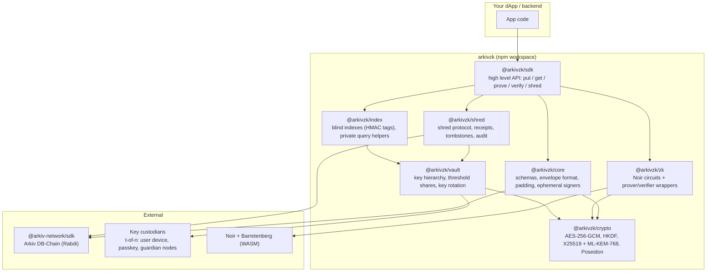
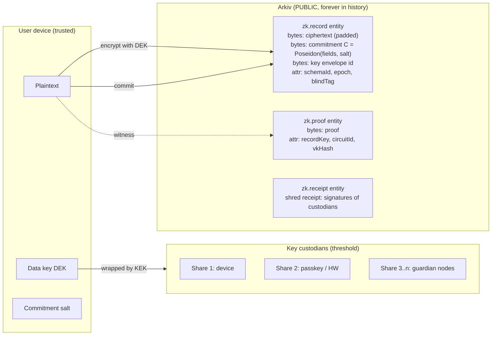
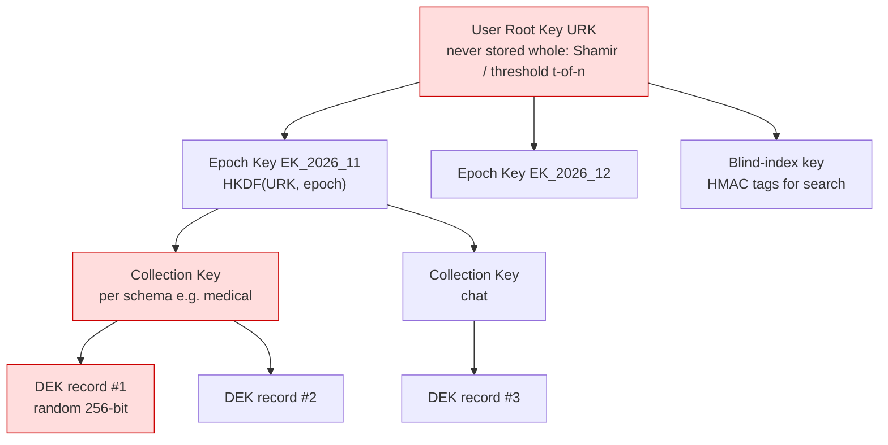
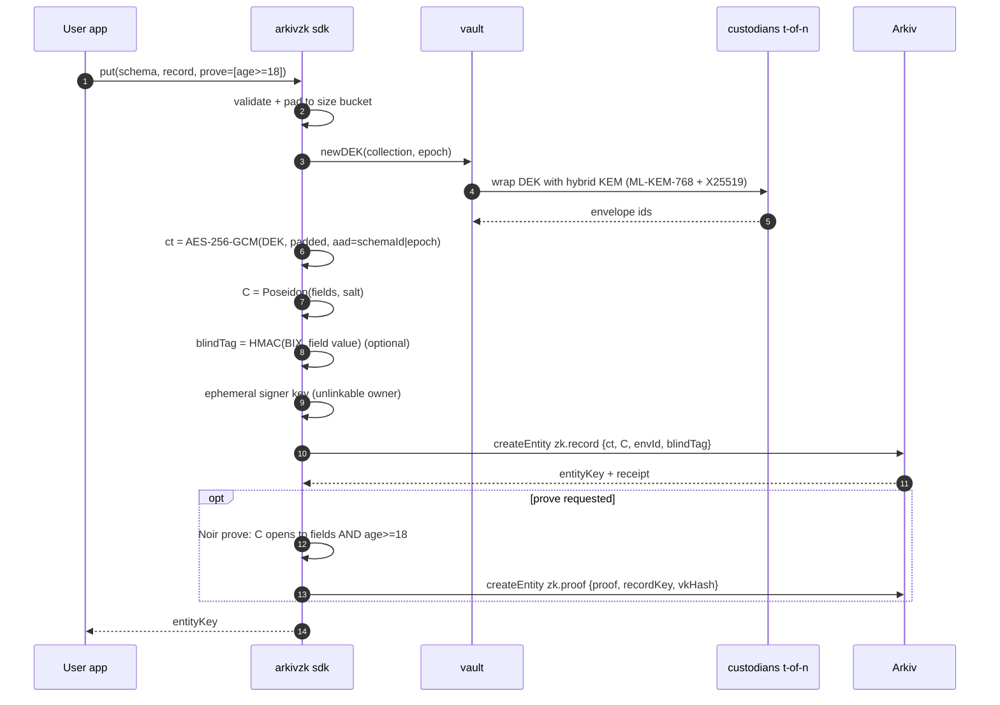
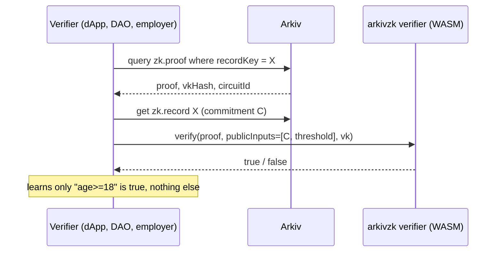
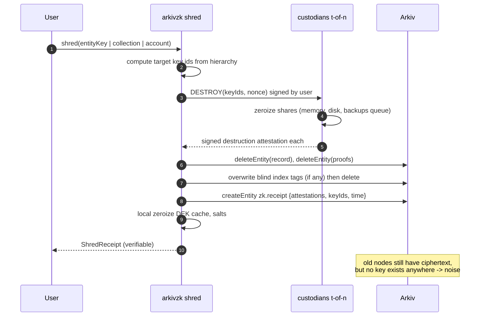
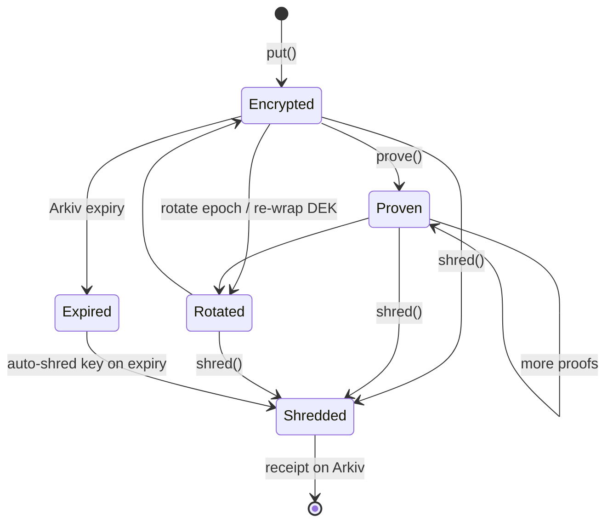

# 02 · Architecture

## 2.1 Library layout (monorepo)

## 2.2 What lives where

Rule: **nothing on Arkiv is ever decryptable without a key that lives off-chain and can be destroyed.**

## 2.3 Key hierarchy (the heart of shredding)

Shred granularity = pick the node to destroy:

| Destroy | Effect |
|---|---|
| one DEK | one record gone |
| collection key | whole collection gone (e.g. all chats) |
| epoch key | everything from one month gone |
| root key shares | **account nuked**: everything ever written, plus blind indexes |

## 2.4 Write flow (`zk.put`)

## 2.5 Verify flow (anyone, no keys)

## 2.6 Shred flow (`zk.shred`) – see doc 04 for full detail

## 2.7 Entity lifecycle state machine

