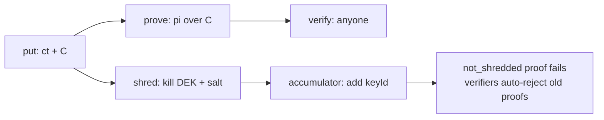

# 03 · ZK end-to-end

"End to end" = ZK at every step a user touches data: **write, prove, query, share, delete**.

## 3.1 Building blocks

| Piece | Choice | Why |
|---|---|---|
| Circuit language | **Noir** | Fast to write, WASM prover in browser + Node, good DX for a hackathon |
| Backend | Barretenberg (UltraHonk) | No per-circuit trusted setup |
| Hash / commitment | Poseidon2 | Cheap in-circuit |
| Data encryption | AES-256-GCM (off-circuit) | Fast, standard |
| Fallback | Circom + Groth16 (snarkjs) | If Noir toolchain fights us |

## 3.2 The core trick: commit + encrypt

Every record stored on Arkiv carries two things:

- `ct` = AES-GCM(DEK, record) → for the owner/authorized readers
- `C`  = Poseidon(field_1, …, field_n, salt) → public anchor for proofs

Proofs are always "**the record committed in C satisfies P**". Verifier needs only `C` (public on
Arkiv) and the proof. No key, no plaintext.

> After shred, `salt` is destroyed together with the DEK. The commitment is hiding, so `C` alone
> reveals nothing even to an archive node.

## 3.3 Circuits we ship (MVP → stretch)

| Circuit | Statement | Use case |
|---|---|---|
| `range` | C opens to field f and `a <= f <= b` | age >= 18, salary band, credit score |
| `equals_hash` | field f equals public value v (or hash) | "nationality = IN" without rest of record |
| `membership` | Merkle proof: my identity commitment is in group root R | anonymous writer ("a verified doctor wrote this") |
| `ownership` | I know the secret behind C (signature-less) | prove authorship across ephemeral signers |
| `nullifier` | one action per identity per scope | anti-spam, one vote, one claim |
| `ct_consistency` (stretch) | ct encrypts the same fields as C (Poseidon-based encryption) | verifiable encryption: reader knows ct isn't garbage |
| `not_shredded` (stretch) | record's key id is NOT in the shred accumulator | "this data is still live" |

## 3.4 Proof entity schema (sketch)

```ts
import { bytes, str, defineSchema } from "@arkiv-network/sdk/schema"

export const ZkRecord = defineSchema("arkivzk.record.v1", {
  schemaId:  str().indexed(),   // e.g. "medical.v1"   (public, coarse)
  epoch:     str().indexed(),   // "2026-11"           (for epoch shred)
  blindTag:  str().indexed(),   // HMAC tag, optional, rotates
  ct:        bytes(),           // padded AES-GCM ciphertext
  commit:    bytes(),           // Poseidon commitment
  envId:     bytes(),           // pointer to key envelope (off-chain custodians)
})

export const ZkProof = defineSchema("arkivzk.proof.v1", {
  recordKey: str().indexed(),
  circuitId: str().indexed(),   // "range.v1"
  vkHash:    str().indexed(),
  publicIn:  bytes(),
  proof:     bytes(),
})
```

(Verify column API against installed `@arkiv-network/sdk` before coding.)

## 3.5 Anonymous writes (hide `$owner`)

`$owner` / tx sender is public. Two layers:

1. **Ephemeral signer per write** (fresh key, funded through a relayer / gas pool) → entities are
   unlinkable by owner.
2. **Membership proof** inside the record: "writer ∈ group R" + nullifier → you get trust
   ("written by a verified member") without identity.

Ephemeral key is kept in the vault so the user can still `deleteEntity` later; it is shredded with
the record.

## 3.6 Private query

Arkiv can only filter on indexed public attributes. Options:

- **Blind index**: `blindTag = HMAC(BIX_key, "email:" + normalized)` → exact-match lookup
  without revealing value. Rotated per epoch to limit linkability. Shredding BIX kills searchability.
- **Coarse buckets**: index `ageBucket = "18-25"` only when user accepts that leak.
- Everything else: fetch by key, decrypt client-side.

## 3.7 ZK + shredding together



Old proofs remain mathematically valid (they were true when made), so verifiers should check
the shred registry / `zk.receipt` entities and treat shredded records as revoked.
