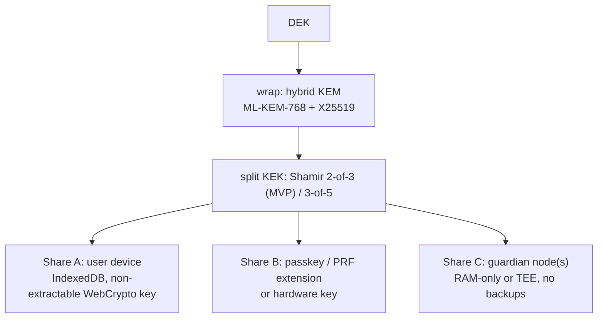
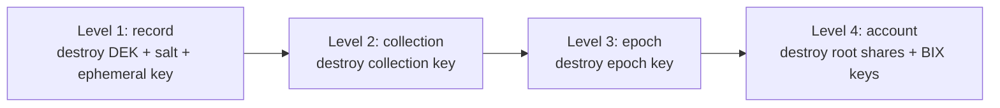
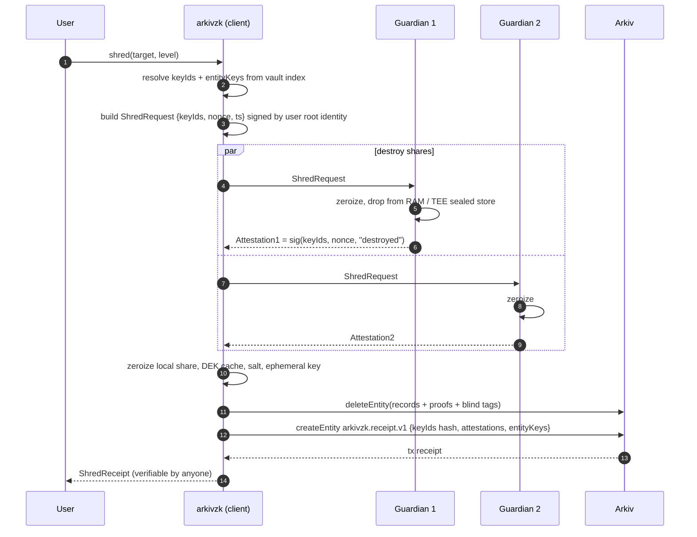

# 04 · Crypto-shredding, god level

## 4.1 The core insight

You cannot delete data from a public chain. Every node runner, indexer and archive that synced
the block keeps the calldata. `deleteEntity` only removes it from current state.

So we never rely on deleting data. **We delete the keys.** If the only copies of the key are
destroyed, every copy of the ciphertext anywhere in the world is permanently random bytes.

That only holds if **keys never touched the chain in a recoverable form**. Every design rule
below exists to make that true.

## 4.2 The ten rules

| # | Rule | Kills which leak |
|---|---|---|
| 1 | Plaintext never on-chain, not even in attributes | Obvious |
| 2 | Per-record random DEK (256-bit), never derived from anything public | One shred = one record, no collateral |
| 3 | DEK only stored wrapped, **off-chain**, by t-of-n custodians | Key never in Arkiv history |
| 4 | Hybrid PQ wrapping: ML-KEM-768 + X25519 → HKDF → AES-KW | Harvest-now-decrypt-later on archived envelopes |
| 5 | AES-256-GCM data encryption with AAD = schemaId, epoch, entity nonce | Swap / replay of ciphertexts |
| 6 | Pad plaintext to size buckets (256B, 1KB, 4KB, 16KB…) | Length fingerprinting of shredded data |
| 7 | Commitments are hiding (salted); salt shredded with DEK | Commitment brute force (e.g. low-entropy fields like age) |
| 8 | Blind-index tags use a per-collection (schema × month) key, so tags rotate monthly; account shred destroys the key they derive from | Searchable linkage after delete |
| 9 | Optional one-time signer per record, gas from a shared relayer pool; its key is deleted after shred | Owner linkage: `$owner` is a fresh address funded by the pool, not your wallet |
| 10 | Every shred produces a signed, public **ShredReceipt** | User trust + auditability |

## 4.3 Custody: where keys live



- Any **t** shares can decrypt → user can lose one device.
- To shred, destroy enough shares that **fewer than t survive anywhere**.
  With 2-of-3: destroying any 2 is enough. We destroy all 3 and collect attestations.
- Guardian nodes: RAM-only or TEE (SGX/TDX/Nitro) with remote attestation, so "we deleted it"
  is backed by hardware, not just a promise. MVP: a simple Node service with in-memory store.

## 4.4 Shred levels

> All four levels are implemented. Record: destroy that record's key. Collection/epoch: destroy the collection key (content key = HKDF(record key ‖ collection key)), which kills every record of that schema and month at once, including ones on other devices. Account: every key plus the vault identity.



## 4.5 Full shred protocol



## 4.6 Why old node runners lose

| What an old node has | Can it recover plaintext? |
|---|---|
| Ciphertext from old block | No – needs DEK |
| Commitment C | No – hiding, salt destroyed |
| Blind tags | Only as random strings – BIX key destroyed |
| Key envelope ids | Just pointers – envelopes were never on-chain |
| Ciphertext length | Only bucket size (padding) |
| Owner address | Ephemeral, unlinked to user |
| Future quantum computer | AES-256 data is safe; no public-key material on-chain to break |

Bonus "god level" mode: even the **wrapped** key never existed outside custodians, so there's no
public-key ciphertext of the key anywhere to attack later.

## 4.7 Honest limits (put these in the UI)

- Anyone who decrypted **before** the shred keeps what they saw. No system can fix that.
- If the user exported/backed up shares themselves, they must shred those too (we show a checklist).
- Guardian honesty: MVP trusts guardians to really zeroize. TEE attestation reduces that trust;
  threshold means one lying guardian is not enough.
- Metadata already published (timestamps, schemaId, bucket size) stays in history.

## 4.8 Auto-shred on expiry

Arkiv entities always expire. Vault watches `$expiresAt`; when a record expires without
Lifetime Extension, the vault auto-shreds its DEK. Expiry becomes real erasure, not just
"hidden from current state".

## 4.9 ShredReceipt schema (sketch)

```ts
export const ShredReceipt = defineSchema("arkivzk.receipt.v1", {
  level:        str().indexed(),   // record | collection | epoch | account
  keyIdsHash:   str().indexed(),   // H(sorted keyIds) – no raw ids
  entityKeys:   bytes(),           // deleted Arkiv entities
  attestations: bytes(),           // guardian signatures (+ TEE quotes if present)
  requestSig:   bytes(),           // user's signed ShredRequest
})
```
