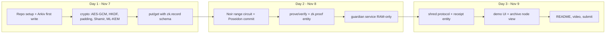

# 05 · MVP plan (limited time)

Mumbai event MCP window ends **2026-11-10**. Plan for ~2.5 days.

## Scope cut

| Must ship (demo) | Nice to have | Later |
|---|---|---|
| `put` / `get` with AES-256-GCM + padding | Blind index search | TEE guardians |
| Per-record DEK, 2-of-3 Shamir (device, passkey-mock, 1 guardian) | Epoch + collection shred | ML-KEM in production config |
| Poseidon commitment + **one Noir circuit: `range`** | `membership` + nullifier circuit | `ct_consistency`, `not_shredded` |
| `verify` in browser, no keys | Ephemeral signer per write | Relayer / gas pool |
| `shred` record-level + `ShredReceipt` entity on Arkiv | Auto-shred on expiry | Account-level shred UI |
| Demo page: "archive node view" showing ciphertext before and after shred | | |

## Day plan



## Demo script (3 minutes)

1. Alice stores a medical record. Show Arkiv explorer: only noise + commitment.
2. Alice proves `age >= 18` to a pharmacy dApp. Pharmacy verifies, sees nothing else.
3. "Archive node" panel copies the raw ciphertext to disk (simulating an old node runner).
4. Alice clicks **Delete forever**. Guardians sign, receipt appears on Arkiv.
5. Archive node tries to decrypt with everything it has: fails. Verifier now rejects old proof
   (record shredded).

## Folder plan for code

```
arkivzk/
  packages/
    crypto/   # aes, hkdf, shamir, padding, poseidon wrapper
    core/     # schemas, envelope format
    vault/    # key hierarchy, shares, custodians client
    zk/       # noir circuits + prove/verify
    shred/    # protocol, receipts
    sdk/      # public API
  guardian/   # tiny Node service, RAM-only share store
  circuits/   # noir projects: range, membership
  demo/       # web demo
  docs/ diagrams/
```

## Open decisions (need answer before coding)

1. Frontend stack for demo: Next.js or plain Vite?
2. Signing mode for Arkiv writes: wallet (preferred) or local env key?
3. Noir vs Circom – default Noir, switch if WASM prover gives trouble.
4. Real ML-KEM now (`@noble/post-quantum`) or X25519-only for MVP with PQ as roadmap slide?
